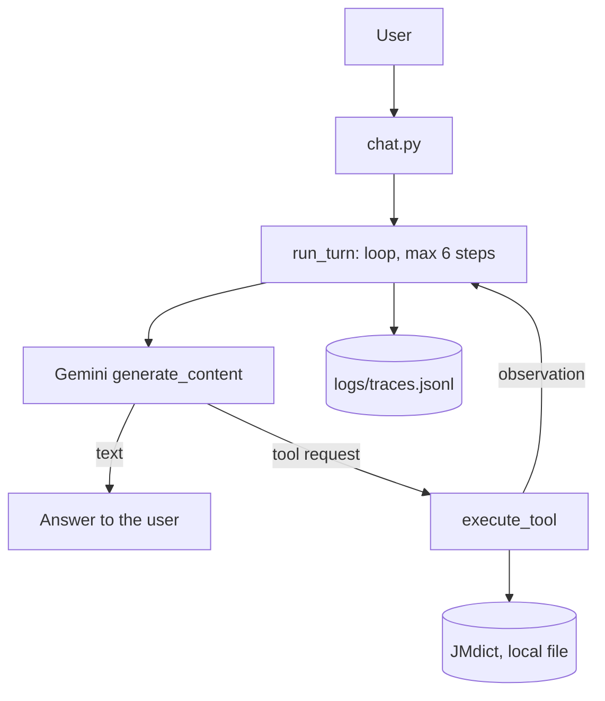

# nihongo-agent

A Japanese-learning tutor agent built from scratch: a hand-written tool-calling loop
(no agent framework) on the Gemini API, with a JMdict dictionary tool and a vocabulary quiz tool.

**Status:** v0.1.0, first version of the pillar project. Memory, RAG over personal notes and
cloud deployment are planned (see [docs/SCOPE.md](docs/SCOPE.md)).

## Problem
When I study, I search the web for readings, meanings and explanations, but jumping between sites is tiring and, as a learner, I cannot easily tell which answer to trust, so it slows me down instead of helping. Dictionary tools such as Jisho already handle lookup well, so the goal is not a better dictionary: it is a study companion that I can talk to in plain language, that quizzes me in the same conversation and that, in later versions, will use my own notes and my own progress (what I got wrong, what I have not seen yet).

## What it does
- Looks up Japanese words (kanji or kana) in JMdict: readings, meanings, part of speech.
- Generates multiple-choice vocabulary quizzes and corrects the answers.
- Chooses by itself whether to use a tool, which one, and when to stop (max 6 steps per turn).
- Writes every step (tool, arguments, tokens, seconds) to `logs/traces.jsonl`.

## Architecture

The model only *requests* a tool (name and arguments); the code executes it and sends the
result back as an observation. Server errors (503) are retried with backoff;
errors raised by tools are returned to the model as observations.

## Quick start
Requirements: Python 3.11+, [uv](https://docs.astral.sh/uv/), a Gemini API key (free tier).
```bash
git clone https://github.com/MMaglians/nihongo-agent
cd nihongo-agent
uv sync
cp .env.example .env        # Windows PowerShell: Copy-Item .env.example .env
# put your key in .env
uv run python scripts/fetch_jmdict.py
uv run python chat.py
```

## Example session
```text
Tu> Cosa vuol dire kanpeki?
  [tool] {"name": "lookup_word", "args": {"word": "完璧"}, "result": {"found": true, "word": "完璧", "entries": [{"kanji": ["完璧", "完ぺき", "完壁"], "readings": ["かんぺき"], "common": true, "senses": [{"pos": ["adjectival nouns or quasi-adjectives (keiyodoshi)", "noun (common) (futsuumeishi)"], "meanings": ["perfect", "

Agente> La parola *kanpeki* (scritta in kanji come **完璧** o 完ぺき) significa "perfetto", "completo" o "senza difetti".

Tu> gambatte, cosa vuol dire?
  [tool] {"name": "lookup_word", "args": {"word": "頑張って"}, "result": {"found": true, "word": "頑張って", "entries": [{"kanji": ["頑張って"], "readings": ["がんばって"], "common": true, "senses": [{"pos": ["interjection (kandoushi)"], "meanings": ["do your best", "go for it", "hang in there", "keep at it"]}]}]}}

Agente> **Gambatte** (頑張って) significa "fai del tuo meglio!", "coraggio!" o "tieni duro!". È una forma esortativa molto comune per incoraggiare qualcuno.

Tu> fammi un quiz di 1 domanda
  [tool] {"name": "make_quiz", "args": {"n": 1}, "result": {"questions": [{"word": "違う", "reading": "ちがう", "options": {"A": "dresser", "B": "whaling", "C": "shallow", "D": "to differ (from)"}, "correct": "D"}]}}

Agente> Ecco una domanda per te!

Cosa significa la parola giapponese **違う** (*chigau*), letta *chigau*?

A) dresser
B) whaling
C) shallow
D) to differ (from)

Rispondi con la lettera corrispondente (A, B, C o D).

Tu> C

Agente> Non è corretto! La risposta giusta era la **D** (*to differ (from)*, cioè "essere diverso" o "sbagliarsi"). La lettura in kana è **ちがう**. 

Vuoi provare un'altra domanda?
```

## Evaluation (v0)
20 hand-written questions in 5 categories, one run each, labelled by hand.
Model: gemini-3.5-flash-lite, 2026-10-30. Confidence intervals: Wilson 95%.

| Metric | Result |
|---|---|
| Correct tool choice | 19/20 (95% CI 0,76-0,99) |
| Correct answer | 20/20 (95% CI 0,84-1,00) |
| Mean steps / mean seconds per question | 1,80 / 4,6 s|
| Mean tokens per question (in / out) | 698 / 74 |

Per category: | Categoria | Domande | Tool corretto | Risposta corretta |
|---|---|---|---|
| parola | 6 | 6/6 | 6/6 |
| lettura | 3 | 3/3 | 3/3 |
| assente | 3 | 3/3 | 3/3 |
| quiz | 3 | 3/3 | 3/3 |
| senza_tool | 5 | 4/5 | 5/5 |
Reproduce: `uv run python eval/run_eval.py`, then `eval/label.py` and `eval/report.py`.
With only 20 questions the intervals are wide: read these numbers as a baseline.

## Limitations
- Only common words: 22,649 entries in the file used (JMdict, common words only; dictionary dated 2026-10-26).
- Step limit: at most 6 model calls per user message. If the limit is reached the agent stops
with a message and may leave the question unanswered. In the evaluation, the stepos limit reached is 0.
- API errors: server errors (5xx) are retried up to 4 times with backoff; quota errors (429) are not retried in the chat. In the evaluation each question gets one retry after 60 s and, if it still fails, it counts as a failure. In the evaluation: 0 API errors.
- Tool choice is not perfect: the model sometimes calls the dictionary for a general-knowledge question or looks up a word it has made up. Answers may include model knowledge outside the dictionary, which the agent is asked to flag as such.
- Quiz distractors are random, so some questions are easy; some glosses carry parentheticals.
- Conversation history lives in memory: nothing is remembered across sessions.
- Small evaluation: 20 questions, one labeller who also wrote them, one run each, single-turn only.
- Free-tier quotas and model names change; the model is configurable in `.env`.

## Cost
Free tier: 0 $. Estimated pay-as-you-go equivalent from the evaluation: 0.00040 $ per question
(gemini-3.5-flash-lite at 0.30 $ / 2.50 $ per million input / output tokens, Google pricing page, 2026-10-30).


## Project structure
```text
nihongo-agent/
├── chat.py                     # command-line chat
├── step_once.py                # day-1 script: one manual tool-calling round trip
├── src/nihongo_agent/
│   ├── agent.py                # the loop: model call, tool execution, step limit
│   ├── tools.py                # tool declarations and registry (lookup_word, make_quiz)
│   ├── dictionary.py           # JMdict loader, lookup and quiz generation
│   ├── tracing.py              # JSONL execution traces
│   ├── retry.py                # backoff on server errors (5xx)
│   ├── evaluation.py           # evaluation loop, metrics, Wilson intervals
│   ├── config.py               # model name and API key from .env
│   └── one_step.py             # single model call used by step_once.py
├── eval/                       # questions, runner, labelling, report, results
├── scripts/fetch_jmdict.py     # downloads the dictionary into data/ (not committed)
├── tests/                      # pytest suite (no network)
├── docs/SCOPE.md               # scope and success criteria
├── DECISIONS.md                # architecture decisions
├── .env.example                # environment variables template
├── LICENSE                     # MIT
└── pyproject.toml              # dependencies (uv)
```

## Data and acknowledgements
This package uses the JMdict dictionary data. These files are the property of the
Electronic Dictionary Research and Development Group (EDRDG) and are used in conformance
with the Group's [licence](https://www.edrdg.org/edrdg/licence.html)
(Creative Commons Attribution-ShareAlike 4.0). See the
[JMdict project](https://www.edrdg.org/wiki/index.php/JMdict-EDICT_Dictionary_Project).
The JSON conversion comes from [jmdict-simplified](https://github.com/scriptin/jmdict-simplified).
The dictionary file is not included in this repository: `scripts/fetch_jmdict.py` downloads it
(re-run it to update the data).

## License
Code: MIT (see LICENSE). Dictionary data: CC BY-SA 4.0, EDRDG.