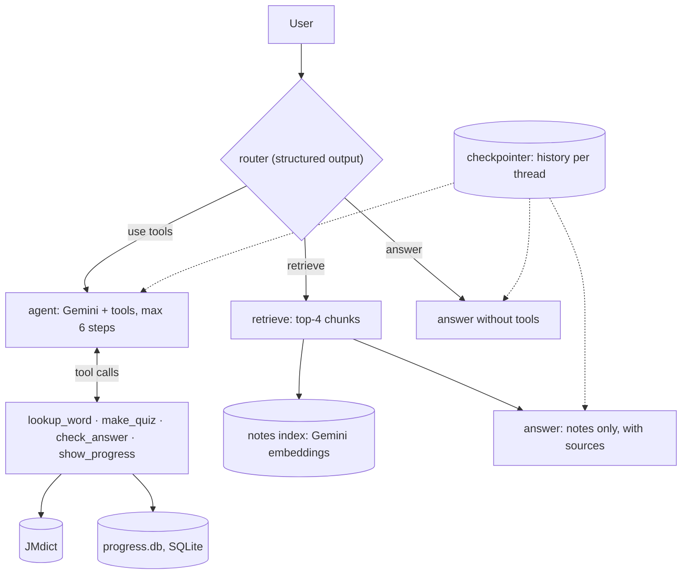

# nihongo-agent

A Japanese-learning tutor agent on the Gemini API, built in two versions: v0 is a hand-written
tool-calling loop (no agent framework) with a JMdict dictionary tool and a vocabulary quiz tool;
v1 puts that loop inside a LangGraph graph with a router, RAG over my handwritten notes and persistent quiz progress.

**Status:** v0.2.0. v1 adds a LangGraph router, RAG over my handwritten notes and progress
memory. The v0 tool loop is kept as a baseline (see [DECISIONS.md](DECISIONS.md)).

## Problem
When I study, I search the web for readings, meanings and explanations, but jumping between sites is tiring and, as a learner, I cannot easily tell which answer to trust, so it slows me down instead of helping. Dictionary tools such as Jisho already handle lookup well, so the goal is not a better dictionary: it is a study companion that I can talk to in plain language, that quizzes me in the same conversation and that, in later versions, will use my own notes and my own progress (what I got wrong, what I have not seen yet).

## What it does
- Looks up Japanese words (kanji or kana) in JMdict: readings, meanings, part of speech.
- Generates multiple-choice vocabulary quizzes and corrects the answers.
- Chooses by itself whether to use a tool, which one, and when to stop (max 6 steps per turn).
- Writes every step (tool, arguments, tokens, seconds) to `logs/traces.jsonl`.
- Routes each message: dictionary/quiz tools, retrieval from my notes, or a plain answer.
- Answers from my own handwritten notes (transcribed and reviewed), citing the source page.
- Checks quiz answers in code, stores progress in SQLite and offers the words I get wrong.

## Architecture (v1)

Notes pipeline (offline): Goodnotes PDF → 5-page blocks → Gemini transcription (Markdown + doubts)
→ manual review → `notes/` → embeddings (cached by fingerprint).

## Quick start
Requirements: Python 3.11+, [uv](https://docs.astral.sh/uv/), a Gemini API key (free tier).
```bash
git clone https://github.com/MMaglians/nihongo-agent
cd nihongo-agent
uv sync
cp .env.example .env        # Windows PowerShell: Copy-Item .env.example .env
# put your key in .env
uv run python scripts/fetch_jmdict.py
# optional: your own notes (private, ignored by Git)
uv run python scripts/transcribe_notes.py raw_notes/notebook.pdf   # writes notes_draft/
# review the files, move them to notes/, then:
uv run python chat_v1.py
```

## Example session
```text
Tu> Cosa vuol dire kanpeki?
  [tool] {"name": "lookup_word", "args": {"word": "完璧"}, "result": {"found": true, "word": "完璧", "entries": [{"kanji": ["完璧", "完ぺき", "完壁"], "readings": ["かんぺき"], "common": true, "senses": [{"pos": ["adjectival nouns or quasi-adjectives (keiyodoshi)", "noun (common) (futsuumeishi)"], "meanings": ["perfect", "

Agente> La parola *kanpeki* (scritta in kanji come **完璧** o 完ぺき) significa "perfetto", "completo" o "senza difetti".

Tu> gambatte, cosa vuol dire?
  [tool] {"name": "lookup_word", "args": {"word": "頑張って"}, "result": {"found": true, "word": "頑張って", "entries": [{"kanji": ["頑張って"], "readings": ["がんばって"], "common": true, "senses": [{"pos": ["interjection (kandoushi)"], "meanings": ["do your best", "go for it", "hang in there", "keep at it"]}]}]}}

Agente> **Gambatte** (頑張って) significa "fai del tuo meglio!", "coraggio!" o "tieni duro!". È una forma esortativa molto comune per incoraggiare qualcuno.

Tu> fammi un quiz di 1 domanda
  [tool] {"name": "make_quiz", "args": {"n": 1}, "result": {"questions": [{"word": "違う", "reading": "ちがう", "options": {"A": "dresser", "B": "whaling", "C": "shallow", "D": "to differ (from)"}, "correct": "D"}]}}

Agente> Ecco una domanda per te!

Cosa significa la parola giapponese **違う** (*chigau*), letta *chigau*?

A) dresser
B) whaling
C) shallow
D) to differ (from)

Rispondi con la lettera corrispondente (A, B, C o D).

Tu> C

Agente> Non è corretto! La risposta giusta era la **D** (*to differ (from)*, cioè "essere diverso" o "sbagliarsi"). La lettura in kana è **ちがう**. 

Vuoi provare un'altra domanda?
```

## Evaluation (v1)
28 questions: the 20 of v0 plus 8 about my notes (6 answerable, 2 on topics absent from the
notes). One run each, labelled by hand by me; criteria fixed and committed before the run
(docs/SCOPE.md §9). Model: gemini-3.5-flash-lite, 2026-11-06. Confidence intervals: Wilson 95%.

| Metric | v1 | Criterion |
|---|---|---|
| Correct route | 25/28 (95% CI 0.73-0.96) | ≥ 25 |
| Correct tool choice | 26/28 (95% CI 0.77-0.98) | ≥ 25 |
| Correct answer | 25/28 (95% CI 0.73-0.96) | ≥ 24 |
| Red line: invented entries / invented notes content | 0 of 3 absent words, 0 of 2 absent topics | 0 |
| Mean model calls per question | 2.61 | ≤ 3.5 |
| Median seconds per question | 2.8 s | ≤ 12 s |
| Mean tokens per question (in / out) | 1,242 / 95 | |
| Pay-as-you-go equivalent cost | 0.00061 $ per question | ≤ 0.003 $ |
| Step limit reached / API errors | 0 / 0 | 0 |

Per category:
| Category | Questions | Route | Tool | Answer |
|---|---|---|---|---|
| word | 6 | 6/6 | 6/6 | 6/6 |
| reading | 3 | 3/3 | 3/3 | 3/3 |
| absent word | 3 | 3/3 | 3/3 | 3/3 |
| quiz | 3 | 3/3 | 3/3 | 3/3 |
| no tool | 5 | 5/5 | 5/5 | 5/5 |
| notes | 6 | 3/6 | 4/6 | 3/6 |
| notes, absent topic | 2 | 2/2 | 2/2 | 2/2 |

**Comparison with v0** on the 20 shared questions (paired sign test): tool choice 20/20 vs 19/20
(1 better, 0 worse, p = 1.0); answer 20/20 vs 20/20 (no discordant pairs). v1 adds routing and
notes without any regression, but the difference is not statistically significant: 20 questions
cannot show it. The cost of the router: 2.61 model calls per question instead of 1.80, and
0.00061 $ instead of 0.00040 $ (about +50%). Mean time per question was 2.8 s vs 4.6 s for v0,
despite the extra call; the runs were on different days, so this difference more likely reflects
API latency on the day than the design, and model drift between runs is also possible.

**Error analysis.** All 3 failures are notes questions that do not mention the notes
("How do you say the days of the week in Japanese?", "What does 読みます mean?",
"What is the translation of 覚えます?"): the router sent them to the dictionary branch, which is a reasonable reading of the question. They are flaws of my test set, not of the router. Excluding
them, route and answer are 25/25 (95% CI 0.87-1.00); both numbers are reported, the questions were
not changed after the run. In one of the three the model also answered from its own knowledge
without saying so, against its instructions. On the notes questions that do mention the notes, 3/3
were answered from the notes and 2/2 absent topics were refused. A chunking bug was also found during error analysis: headings placed right after the page markers were not detected, so citations show the file name instead of the section. Fixed in
this release (`load_chunks`); the notes questions were not re-evaluated after the fix.

**Transcription quality** on 20 reviewed pages (of 147): 15 misreadings corrected (0.75 per page),
all of them flagged by the model among its 20 doubts (2 false alarms). In my own notes I corrected
4 real mistakes (3 flagged by the model) and normalised 5 romaji long vowels to one convention
(juu, you, -shou). Errors missed by both the model and me cannot be counted.

Reproduce: `uv run python eval/run_eval_v1.py`, then `eval/label_v1.py` and `eval/report_v1.py`.
`eval/results_v1.json` omits the answers that quote my notes.


## Evaluation (v0)
20 hand-written questions in 5 categories, one run each, labelled by hand.
Model: gemini-3.5-flash-lite, 2026-10-30. Confidence intervals: Wilson 95%.

| Metric | Result |
|---|---|
| Correct tool choice | 19/20 (95% CI 0.76-0.99) |
| Correct answer | 20/20 (95% CI 0.84-1.00) |
| Mean steps / mean seconds per question | 1.80 / 4.6 s|
| Mean tokens per question (in / out) | 698 / 74 |

Per category:

| Category | Questions | Correct tool | Correct answer |
|---|---|---|---|
| word | 6 | 6/6 | 6/6 |
| reading | 3 | 3/3 | 3/3 |
| absent word | 3 | 3/3 | 3/3 |
| quiz | 3 | 3/3 | 3/3 |
| no tool | 5 | 4/5 | 5/5 |

Reproduce: `uv run python eval/run_eval.py`, then `eval/label.py` and `eval/report.py`.

## Limitations
**Dictionary and tools**
- Only common words: 22,649 entries in the file used (JMdict, common words only; dictionary dated 2026-10-26).
- No deinflection: conjugated forms such as 読みます are not found (only the dictionary form 読む);
the model then falls back to general knowledge, which it is asked to flag as such.
- Tool choice is not perfect: the model sometimes calls the dictionary for a general-knowledge
question, and in one v1 evaluation answer it replied from its own knowledge without saying so.
- Quiz distractors are random, so some questions are easy; some glosses carry parentheticals.
- Step limit: at most 6 model calls per tool loop. If the limit is reached the agent stops with a
message and may leave the question unanswered (reached 0 times in both evaluations).

**Router and memory (v1)**
- The router adds one model call per turn and sees only the last tutor message, not the full history.
- Conversation history is kept per thread and in memory only; across sessions only quiz progress
persists (SQLite). Progress is recorded only when the model calls `check_answer`; multi-turn quiz  behaviour was tested by hand, not in the evaluation.

**My notes**
- Only 20 of 147 transcribed pages are reviewed and indexed; the other pages are not used.
- The notes are mostly in romaji with few kanji and contained mistakes; reviewed pages were
corrected, but answers from notes can still repeat errors that neither the model nor I noticed.  Questions written in kana may retrieve romaji notes less well.
- Handwriting transcription can misread words (15 misreadings in 20 reviewed pages, all corrected).
- The model numbered pages within each 5-page block from 1; fixed in code after the review, so page markers in the reviewed files may be shifted.
- The notes questions were evaluated before a chunking fix (see Evaluation v1) and not re-run.

**API**
- Server errors (5xx) are retried up to 4 times with backoff; quota errors (429) are not retried in
the chat. In the evaluations each question gets one retry after 60 s (0 API errors in both runs).
The free tier returned repeated 503 errors during the transcription; the script resumes where it stopped.
- Free-tier quotas and model names change; models are configurable in `.env`.

**Evaluation**
- Small evaluations: 20 questions (v0) and 28 (v1), one run each, single-turn, labelled by one
person who also wrote the questions. Intervals are wide: read the numbers as baselines.
- 3 of the 6 notes questions did not mention the notes, so the router could not know the answer was expected from them; they must be rewritten for the next evaluation.
- v0 and v1 were run on different days (2026-10-30 and 2026-11-06): latency differences and model drift between runs are possible.


## Cost
Free tier: 0 $. Estimated pay-as-you-go equivalent, from the evaluations:

| | Model calls per question | Cost per question |
|---|---|---|
| v0 (tool loop) | 1.80 | 0.00040 $ |
| v1 (router + tool loop / notes) | 2.61 | 0.00061 $ (about +50%) |

Prices: gemini-3.5-flash-lite at 0.30 $ / 2.50 $ per million input / output tokens (Google pricing
page, 2026-10-30); gemini-embedding-001 at 0.15 $ per million input tokens (Google Developers Blog).
The v1 figure includes the router call and the query embedding for notes questions (estimated at
about 30 tokens per query, because embedding token counts are not logged).
One-off costs, not included above: the notebook transcription (one call per 5-page block, about 30
calls plus retries; token usage not logged, so its cost is not measured) and the embedding of the
note chunks, which is cached and recomputed only when the notes change.


## Project structure
```text
   nihongo-agent/
   ├── chat.py                     # v0 command-line chat
   ├── chat_v1.py                  # v1 command-line chat (LangGraph)
   ├── step_once.py                # day-1 script: one manual tool-calling round trip
   ├── src/nihongo_agent/
   │   ├── agent.py                # v0 loop: model call, tool execution, step limit
   │   ├── tools.py                # v0 tools (lookup_word, make_quiz)
   │   ├── graph.py                # v1 graph: router, tool loop, retrieval, answer
   │   ├── tools_v1.py             # v1 tools (adds check_answer, show_progress)
   │   ├── notes.py                # chunking, embeddings and search over my notes
   │   ├── progress.py             # quiz progress in SQLite
   │   ├── transcribe.py           # handwritten PDF to Markdown with Gemini
   │   ├── dictionary.py           # JMdict loader, lookup and quiz generation
   │   ├── tracing.py              # JSONL execution traces
   │   ├── retry.py                # backoff on server errors (5xx)
   │   ├── evaluation.py           # v0 evaluation, metrics, Wilson intervals
   │   ├── evaluation_v1.py        # v1 evaluation and paired comparison with v0
   │   ├── config.py               # model names and API key from .env
   │   └── one_step.py             # single model call used by step_once.py
   ├── eval/                       # questions, runners, labelling, reports, results (v0 and v1)
   ├── scripts/
   │   ├── fetch_jmdict.py         # downloads the dictionary into data/ (not committed)
   │   └── transcribe_notes.py     # transcribes the notebook into notes_draft/
   ├── tests/                      # pytest suite (no network)
   ├── docs/SCOPE.md               # scope and success criteria
   ├── docs/context_and_memory.md  # consulting memo: what goes in the context vs in memory
   ├── DECISIONS.md                # architecture decisions
   ├── .env.example                # environment variables template
   ├── LICENSE                     # MIT
   └── pyproject.toml              # dependencies (uv)
```

## Data and acknowledgements
This package uses the JMdict dictionary data. These files are the property of the
Electronic Dictionary Research and Development Group (EDRDG) and are used in conformance
with the Group's [licence](https://www.edrdg.org/edrdg/licence.html)
(Creative Commons Attribution-ShareAlike 4.0). See the
[JMdict project](https://www.edrdg.org/wiki/index.php/JMdict-EDICT_Dictionary_Project).
The JSON conversion comes from [jmdict-simplified](https://github.com/scriptin/jmdict-simplified).
The dictionary file is not included in this repository: `scripts/fetch_jmdict.py` downloads it
(re-run it to update the data).

**My notes are private.** The handwritten notebook, its PDF export, the transcripts, the notes index, the progress database and the full evaluation results are not in this repository and are excluded by `.gitignore` (`raw_notes/`, `notes_draft/`, `notes/`, `data/`, `logs/`). `eval/results_v1.json` replaces the answers that quote my notes with a placeholder. The notes are sent to the Gemini API for transcription and embeddings; under the Gemini API Additional Terms (read on 2026-10-30), for users in the EEA prompts and responses are not used to improve Google's products.
Course materials I studied from (Marugoto, The Japan Foundation) are not included or indexed: their terms allow personal use only.

## License
Code: MIT (see LICENSE). Dictionary data: CC BY-SA 4.0, EDRDG.